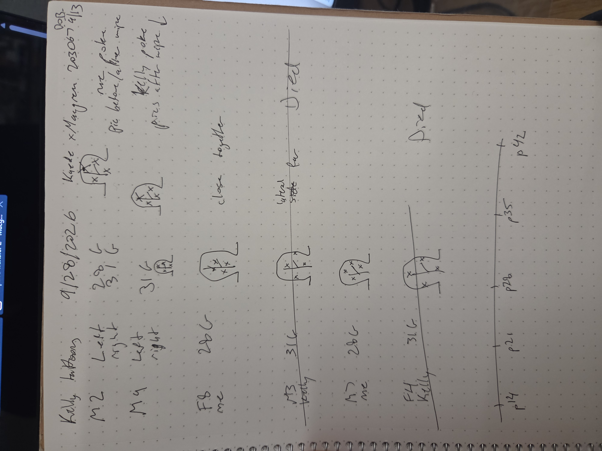

- [[Sep 28th, 2026]]
	- first trial run of tattooing p14 mice to track growth curve
	- Kaede x Macgreen breeding cage 203067 born 9/13
		- so p15
	- Mice weighed 7g, gave ~40-50 uL ketamine
		- this was too much :(
	- Me
		- M2
			- left ear 28G, right ear 31G
		- F8
			- 31G
		- M7
			- 31G
	- Kelly
		- All tattoos were with 31G needle
		- M9
		- ~~M3~~
			- died from anesthesia
		- ~~F4~~
			- died from anesthesia
	- Notes from notebook:
	  collapsed:: true
		- 